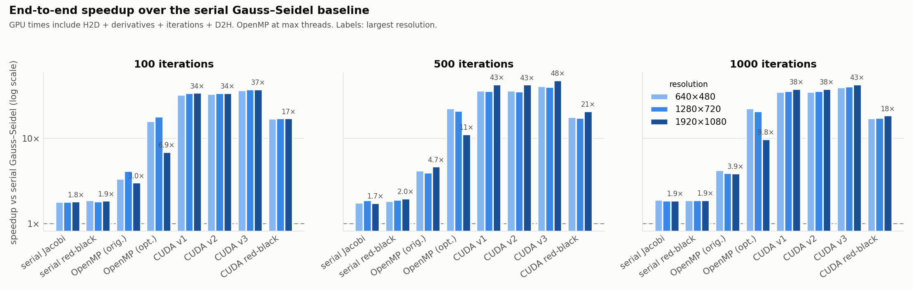
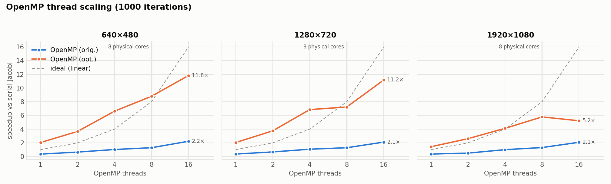
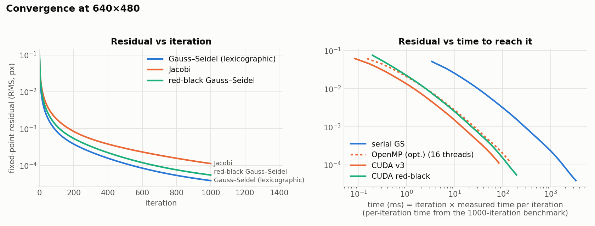

# Horn–Schunck Optical Flow: Serial, OpenMP and CUDA

Dense optical flow with the Horn–Schunck (HS) method in C++17 / OpenCV, implemented
four ways and measured against each other:

| family | versions | iteration scheme |
|---|---|---|
| serial CPU | `serial-gs`, `serial-jacobi`, `serial-rb` | Gauss–Seidel (lexicographic), Jacobi, red-black Gauss–Seidel |
| OpenMP CPU | `omp` (original), `omp-opt` (restructured) | Jacobi |
| CUDA GPU | `cuda-v1`, `cuda-v2`, `cuda-v3` | Jacobi (naive → shared-memory tiling → fused data layout) |
| CUDA GPU | `cuda-rb` | red-black Gauss–Seidel |

Every implementation solves exactly the same discrete problem. Each one is checked
automatically against a CPU reference before it's benchmarked (see [Correctness](#correctness)).

**Headline** (1920×1080, 1000 iterations, RTX 2050 laptop GPU vs i7-11800H, end-to-end including transfers):

| | time | CUDA v3 speedup |
|---|---:|---:|
| serial Gauss–Seidel (original baseline) | 23 769 ms | **42.7×** |
| original OpenMP, 16 threads | 6 112 ms | **11.0×** |
| restructured OpenMP (`omp-opt`), best thread count (8) | 2 194 ms | **3.9×** |
| CUDA v3 | 556 ms | |

All GPU iteration kernels run at **95–96% of peak DRAM bandwidth** (Nsight Compute), so they're
memory-bound. On the GPU, the only optimization that helped was moving fewer bytes per pixel.

---

## Contents
- [Algorithm](#algorithm)
- [Architecture: how each version parallelizes](#architecture-how-each-version-parallelizes)
- [Correctness](#correctness)
- [Build](#build)
- [Usage](#usage)
- [Benchmarks](#benchmarks)
- [Profiling](#profiling)
- [Flow visualizations](#flow-visualizations)
- [Caveats](#caveats)
- [Files](#files)

---

## Algorithm

HS assumes:
1. **Brightness constancy:** a point keeps its intensity between frames.
2. **Smooth flow:** neighbouring pixels move similarly.

It minimizes a data term (brightness constancy, via image derivatives Ix, Iy, It)
plus α² times a smoothness term. The resulting equations are solved iteratively.

**Discretization used here** (identical in all versions):

- Frames are grayscale, float32 in [0, 1].
- Both frames are smoothed with a 5×5 Gaussian (σ = 1, replicated border).
- `Ix`, `Iy` = 3×3 Sobel of the smoothed first frame, scaled by 0.5. `It` = I2s − I1s.
- Neighbour average ū, v̄ = **4-neighbour mean** (weights ¼; not the original HS 1/6 + 1/12 kernel).
- Update for every interior pixel:

  ```
  t  = (Ix·ū + Iy·v̄ + It) / (α² + Ix² + Iy²)
  u' = ū − Ix·t
  v' = v̄ − Iy·t
  ```
- **Boundary:** the one-pixel border is never updated and stays at zero flow.
- Defaults: α = 0.5, 100 iterations, zero initial flow.

**Iteration schemes**

| scheme | update order | parallelism |
|---|---|---|
| Jacobi | every pixel reads only the previous iteration (two buffers, swapped) | fully parallel, deterministic |
| Gauss–Seidel (lexicographic) | in place, row by row; uses values already updated this sweep | inherently sequential |
| Red-black Gauss–Seidel | in place, checkerboard: all "red" pixels, then all "black" | each half-sweep is fully parallel |

Gauss–Seidel variants converge in fewer iterations than Jacobi. Only Jacobi and red-black
can use many cores. Which one gives the solution sooner in **wall-clock time** is a question
for measurement; see [Convergence](#convergence).

---

## Architecture: how each version parallelizes

### OpenMP (CPU)
- **`omp` (original):** `#pragma omp parallel for collapse(2)` over the interior (y, x) loop
  of each Jacobi sweep, using `cv::Mat::at<float>`. The border rows and columns are copied
  every iteration.
- **`omp-opt`:** the same arithmetic, with bit-identical results, restructured for throughput:
  - `parallel for` over **rows only**. Each thread gets a contiguous block of rows, so
    every thread streams through memory in order.
  - The inner loop uses raw row pointers (`ptr<float>(y-1/y/y+1)`). With no per-pixel
    index division from `collapse` and no `Mat` indirection, the compiler can keep the
    pointers in registers and vectorize.
  - No per-iteration border copies (the zero border never changes).
- The thread count is set per run with `omp_set_num_threads`. OpenCV's internal threading
  (used for the Gaussian/Sobel step) is set to the same count, so "1 thread" really is serial.

### CUDA (GPU)

The pipeline runs entirely on the device. The only host↔device traffic is one upload of the
two frames and one download of (u, v):

```
H2D: I1, I2 ─► Gaussian row/col (×2) ─► derivatives: Ix, Iy, It, α²+Ix²+Iy²
          ─► [v3/rb: fold coefficients] ─► N × iteration kernel (ping-pong or in place)
          ─► [v3/rb: split u,v] ─► D2H: u, v
```

- **Derivatives on the GPU** mirror OpenCV's separable filters: symmetric taps are evaluated
  in the same order, and `__fmul_rn`/`__fadd_rn` stop FMA contraction. The 5 Gaussian taps
  come from `cv::getGaussianKernel` and are stored in `__constant__` memory.
- **Thread mapping:** one thread per pixel, 32×8 blocks, `threadIdx.x` along columns. A warp
  therefore reads one contiguous 128-byte row segment (coalesced).
- **Ping-pong buffers:** Jacobi kernels read buffer *cur* and write *nxt*. The host swaps
  indices, so nothing is copied between iterations. Border threads write nothing, and both
  buffers start zeroed, which reproduces the CPU's fixed zero border.
- **`hs::gpu::Solver`** owns all device buffers for one image size, so benchmarks never time
  `cudaMalloc`.
- **Error handling:** every runtime call is wrapped in `CUDA_CHECK`, and every launch is
  followed by `CUDA_CHECK_LAUNCH` (`cudaGetLastError`, plus `cudaDeviceSynchronize` in debug builds).

| version | what changes | idea |
|---|---|---|
| `cuda-v1` naive | all neighbour and coefficient reads straight from global memory | baseline: correct and simple |
| `cuda-v2` shared | each block stages its 32×8 u/v tile + 1-pixel halo in shared memory | read each u/v value from global memory once per block instead of up to 5× |
| `cuda-v3` fused layout | u,v interleaved as `float2`; coefficients folded to p,q,r = (Ix,Iy,It)/√(α²+Ix²+Iy²) so `t = p·ū + q·v̄ + r; u' = ū − p·t; v' = v̄ − q·t`; `__restrict__` + `__ldg` | the same math with no division and 3 instead of 4 coefficient arrays: minimum DRAM traffic per pixel per sweep drops from 32 B to 28 B |
| `cuda-rb` red-black | v3 layout, updated **in place** in two launches per iteration (red, then black); one thread per pixel of the active colour | Gauss–Seidel convergence with GPU parallelism; no race, because a pixel's 4 neighbours all have the other colour |

A note on "fused": the update for u and v share `t`, so every version (even v1) updates u and
v in one kernel. Splitting them would only recompute `t` twice. In v3, "fused" refers to the
**data**: u and v in one `float2` stream, and four coefficient arrays folded into three.

---

## Correctness

`opt-flow-parallel validate` runs each implementation on the same input and iteration count
and compares it with a reference:

| implementation | reference | criterion |
|---|---|---|
| `serial-jacobi`, `omp-opt` | `omp` (original OpenMP Jacobi) | **bit-identical** |
| `cuda-v1`, `cuda-v2`, `cuda-v3` | `omp` | max \|Δu\|, \|Δv\| ≤ 1e-4 px and mean endpoint error ≤ 1e-6 px |
| `cuda-rb` | `serial-rb` (same update order on the CPU) | same float tolerance |

The CUDA tolerance allows for float32 evaluation-order and FMA differences. It sits about 3×
above the worst error measured for v1, so a real indexing or boundary bug would still fail.
Partial-block sizes (37×5, 641×479) are included to exercise grid and halo edges. The
refactor of the original serial and OpenMP code was also checked to be bit-identical to the
pre-refactor output.

Latest validation output: [`results/validation.txt`](results/validation.txt). It covers
37×5, 641×479, 640×480, 1280×720 and 1920×1080 at 100/500/1000 iterations, with 0 failures.
Worst case over all of them:

| implementation | max \|Δu\|, \|Δv\| (px) | mean endpoint error (px) |
|---|---:|---:|
| `serial-jacobi`, `omp-opt` | 0 (bit-identical) | 0 |
| `cuda-v1`, `cuda-v2`, `cuda-v3` | 2.8e-5 | 3.1e-7 |
| `cuda-rb` (vs `serial-rb`) | 3.5e-5 | 3.8e-7 |

For scale, the flow itself reaches 9 px at 1080p / 1000 iterations.

---

## Build

Requirements: C++17 compiler, CMake ≥ 3.24, OpenCV 4 (core, imgproc, imgcodecs, highgui),
OpenMP. Optional: CUDA Toolkit (tested with 13.0) for the GPU versions.

CUDA is **optional**. CMake uses `check_language(CUDA)` and builds CPU-only when no CUDA
compiler is found.

### Linux

```bash
sudo apt install build-essential cmake libopencv-dev    # + CUDA toolkit for GPU versions
```

```bash
cmake -S . -B build -DCMAKE_BUILD_TYPE=Release
```

```bash
cmake --build build -j
```

The executable is `build/opt-flow-parallel`.

### Windows (MSVC)

nvcc on Windows requires MSVC as its host compiler, so build everything with Visual Studio
2022 (Build Tools are enough). Use the official OpenCV Windows package (`opencv-4.x-windows.exe`,
which contains MSVC `vc16` libraries).

```bash
cmake -S . -B build -G "Visual Studio 17 2022" -A x64 -DOpenCV_DIR=C:/tools/opencv/build
```

```bash
cmake --build build --config Release
```

The executable is `build/Release/opt-flow-parallel.exe`; the OpenCV DLL is copied next to it.
MSVC's LLVM OpenMP runtime (`/openmp:llvm`) is selected automatically, because the default
MSVC runtime only supports OpenMP 2.0 and ignores `collapse`.

### CPU-only, or a specific GPU architecture

```bash
cmake -S . -B build -DOFP_ENABLE_CUDA=OFF
```

```bash
cmake -S . -B build -DCMAKE_CUDA_ARCHITECTURES=86
```

`CMAKE_CUDA_ARCHITECTURES` defaults to `native` (the GPUs in the build machine).

### No NVIDIA GPU?

[`colab/run_on_colab.ipynb`](colab/run_on_colab.ipynb) clones the repo, builds it with CMake +
nvcc on a Colab GPU, runs validation, benchmarks and profiling, and shows the charts.

---

## Usage

```bash
./run.sh
```

`./run.sh` is the original demo: serial + OpenMP on `data/rm1.jpg`, `data/rm2.jpg`, with
arrow plots and a GUI window.

```text
opt-flow-parallel <command> [frame1 frame2] [options]

  bench        time every (impl, size, iterations, threads) combination
  validate     compare Jacobi variants against OpenMP Jacobi, cuda-rb against serial-rb
  convergence  record the fixed-point residual after every iteration
  flow         save HSV color-coded flow images

  --impl LIST     serial-gs, serial-jacobi, serial-rb, omp, omp-opt, cuda-v1, cuda-v2, cuda-v3, cuda-rb, all
  --size LIST     WxH or native            --iters LIST     iteration counts
  --threads LIST  OpenMP threads, max = omp_get_max_threads()
  --runs N        timed runs (median)      --warmup N       untimed warm-up runs
  --alpha A       regularization           --csv FILE       write CSV   --append
```

Example:

```bash
build/Release/opt-flow-parallel.exe bench --impl omp-opt,cuda-v3 --size 1920x1080 --iters 1000 --threads 1,8,max
```

Everything in [Benchmarks](#benchmarks) is regenerated by:

```bash
scripts/run_benchmarks.sh
```

The profiling data comes from:

```bash
scripts/profile.sh
```

---

## Benchmarks

### Method
- **GPU timing:** `cudaEvent`s on the solver's stream. Reported separately:
  - **H2D**: upload of both float32 frames
  - **compute**: Gaussian, derivatives, all iterations, layout conversion
  - **D2H**: download of u and v
  - **total**: first upload to last download
  Device allocation happens once per image size and is not timed. Host buffers are
  ordinary pageable memory (no pinned staging).
- **CPU timing:** `std::chrono::steady_clock` around the whole solver call
  (derivatives + iterations).
- Every configuration does warm-up runs (1 for CPU, 3 for GPU) and then reports the
  **median of 10 timed runs** (min and max are also in the CSV).
- **Input:** `data/rm1.jpg` → `data/rm2.jpg` (1600×999), resized to each resolution
  (INTER_AREA when shrinking, bilinear when enlarging to 1920×1080). α = 0.5.
- Raw data: [`results/benchmark.csv`](results/benchmark.csv). Tables and charts are
  generated from it by [`scripts/plot_results.py`](scripts/plot_results.py).

### Hardware and software

| | |
|---|---|
| CPU | Intel Core i7-11800H @ 2.30 GHz, 8 cores / 16 threads (laptop) |
| GPU | NVIDIA GeForce RTX 2050 (laptop), sm_86, 16 SMs, 4 GiB, 64-bit bus, 112 GB/s theoretical peak DRAM bandwidth (from reported memory clock × bus width), 1 MiB L2 |
| Driver / CUDA | driver reports 13.3; built with CUDA Toolkit 13.0 |
| Host compiler | MSVC 19.41 (Visual Studio 2022 Build Tools), `/O2`, `/openmp:llvm` |
| OpenCV | 4.14.0 |
| OS | Windows 11 (WDDM driver model) |

The program prints this information at the start of every benchmark and writes it to
[`results/system_info.txt`](results/system_info.txt).

### Results

1920×1080, the largest configuration. All three resolutions are in
[`results/tables.md`](results/tables.md), and raw medians/min/max are in
[`results/benchmark.csv`](results/benchmark.csv). Medians of 10 runs, in ms. OpenMP rows use 16 threads.

| implementation | threads | iterations | total | compute | H2D | D2H | speedup vs serial-gs | speedup vs serial-jacobi |
|---|---:|---:|---:|---:|---:|---:|---:|---:|
| serial-gs | 1 | 100 | 2309.82 | 2309.82 |  |  | 1.0× | 0.5× |
| serial-jacobi | 1 | 100 | 1270.15 | 1270.15 |  |  | 1.8× | 1.0× |
| serial-rb | 1 | 100 | 1242.14 | 1242.14 |  |  | 1.9× | 1.0× |
| omp | 16 | 100 | 762.33 | 762.33 |  |  | 3.0× | 1.7× |
| omp-opt | 16 | 100 | 332.79 | 332.79 |  |  | 6.9× | 3.8× |
| cuda-v1 | – | 100 | 67.85 | 63.40 | 2.03 | 2.42 | 34.0× | 18.7× |
| cuda-v2 | – | 100 | 67.98 | 63.49 | 2.01 | 2.45 | 34.0× | 18.7× |
| cuda-v3 | – | 100 | 61.66 | 57.25 | 2.00 | 2.40 | 37.5× | 20.6× |
| cuda-rb | – | 100 | 134.68 | 130.18 | 2.07 | 2.43 | 17.2× | 9.4× |
| serial-gs | 1 | 500 | 13473.59 | 13473.59 |  |  | 1.0× | 0.6× |
| serial-jacobi | 1 | 500 | 7708.79 | 7708.79 |  |  | 1.7× | 1.0× |
| serial-rb | 1 | 500 | 6803.30 | 6803.30 |  |  | 2.0× | 1.1× |
| omp | 16 | 500 | 2884.86 | 2884.86 |  |  | 4.7× | 2.7× |
| omp-opt | 16 | 500 | 1203.76 | 1203.76 |  |  | 11.2× | 6.4× |
| cuda-v1 | – | 500 | 315.67 | 311.16 | 2.08 | 2.44 | 42.7× | 24.4× |
| cuda-v2 | – | 500 | 316.21 | 311.63 | 2.08 | 2.48 | 42.6× | 24.4× |
| cuda-v3 | – | 500 | 281.52 | 276.93 | 2.12 | 2.46 | 47.9× | 27.4× |
| cuda-rb | – | 500 | 646.20 | 641.64 | 2.07 | 2.43 | 20.9× | 11.9× |
| serial-gs | 1 | 1000 | 23768.54 | 23768.54 |  |  | 1.0× | 0.5× |
| serial-jacobi | 1 | 1000 | 12684.61 | 12684.61 |  |  | 1.9× | 1.0× |
| serial-rb | 1 | 1000 | 12593.63 | 12593.63 |  |  | 1.9× | 1.0× |
| omp | 16 | 1000 | 6112.24 | 6112.24 |  |  | 3.9× | 2.1× |
| omp-opt | 16 | 1000 | 2430.64 | 2430.64 |  |  | 9.8× | 5.2× |
| cuda-v1 | – | 1000 | 625.59 | 620.89 | 2.12 | 2.51 | 38.0× | 20.3× |
| cuda-v2 | – | 1000 | 626.46 | 621.82 | 2.10 | 2.46 | 37.9× | 20.2× |
| cuda-v3 | – | 1000 | 556.07 | 551.54 | 2.07 | 2.46 | 42.7× | 22.8× |
| cuda-rb | – | 1000 | 1285.66 | 1281.05 | 2.10 | 2.45 | 18.5× | 9.9× |

Things to note:
- **Transfers are small.** H2D + D2H come to about 4.5 ms at 1080p, under 1% of the 1000-iteration total.
  CUDA speedups are about the same with or without them.
- **GPU speedups barely change with iteration count**, because nearly all the time is in the
  iteration kernel. Setup kernels (Gaussian, derivatives) take about 1 ms per run in the nsys trace.
- **The original OpenMP code is slower than serial Jacobi until about 4 threads.** With 1 thread at
  1080p it takes 35.3 s vs 12.7 s for serial Jacobi, from the `collapse(2)` index arithmetic and
  `Mat::at` in the outlined loop. `omp-opt` fixes this with identical results.
- **`serial-gs` is 1.7–1.9× slower per iteration than serial Jacobi.** The in-place dependency
  prevents vectorization, but GS also converges in fewer iterations (see [Convergence](#convergence)).
- **Noisy rows:** the short (100-iteration) `omp-opt` runs at 1080p vary a lot between runs. At
  16 threads they range from 270 to 378 ms around the 333 ms median; compare 2143–2264 ms for
  1000 iterations at 8 threads (min/max in the CSV). The trend is the same at every iteration
  count, though: at 1080p, 16 threads is slower than 8.

### Speedup



CUDA v1–v3 reach 32.5–47.9× over the serial Gauss–Seidel baseline across all sizes and
iteration counts, and red-black 16.9–20.9×. Ranking: v3 fastest, v1 ≈ v2, then red-black.
The OpenMP bars use 16 threads, which isn't the best setting at 1080p (see the next section).

### OpenMP thread scaling



Total ms at 1000 iterations. In parentheses: speedup vs `serial-jacobi`.

| implementation | resolution | 1 thr | 2 thr | 4 thr | 8 thr | 16 thr |
|---|---|---:|---:|---:|---:|---:|
| omp | 640×480 | 5061.6 (0.3×) | 2739.7 (0.6×) | 1729.4 (1.0×) | 1378.9 (1.3×) | 794.4 (2.2×) |
| omp-opt | 640×480 | 866.7 (2.0×) | 483.0 (3.7×) | 267.1 (6.6×) | 200.9 (8.8×) | 149.4 (11.8×) |
| omp | 1280×720 | 14990.8 (0.4×) | 8035.9 (0.7×) | 5039.3 (1.1×) | 4184.4 (1.3×) | 2548.6 (2.1×) |
| omp-opt | 1280×720 | 2626.8 (2.0×) | 1430.1 (3.7×) | 782.8 (6.8×) | 741.9 (7.2×) | 479.9 (11.2×) |
| omp | 1920×1080 | 35333.1 (0.4×) | 25674.6 (0.5×) | 12699.0 (1.0×) | 9715.8 (1.3×) | 6112.2 (2.1×) |
| omp-opt | 1920×1080 | 8891.8 (1.4×) | 4869.4 (2.6×) | 3085.5 (4.1×) | 2193.7 (5.8×) | 2430.6 (5.2×) |

- **`omp-opt` is faster than serial Jacobi even with 1 thread** (1.4–2.0×): raw row pointers let
  MSVC vectorize the inner loop. Relative to its own 1-thread time it scales 5.8× at 640×480
  (16 threads) but only 4.1× at 1080p (best at 8 threads; 16 threads is slower).
- **Probable cause (a hypothesis; CPU memory counters weren't measured):** the eight float
  planes a Jacobi sweep touches take about 9.8 MB at 640×480, which fits in the i7-11800H's 24 MB
  L3. At 1080p they take about 66 MB, so every sweep streams from DRAM. At 8 threads the
  1080p run moves at least 32 B × 2.07 M pixels × 1000 sweeps / 2.19 s ≈ 30 GB/s, and more
  threads can't add bandwidth. Above 8 threads the extra workers are hyper-threads sharing cores.
- **The original `omp` reaches only 2.1–2.2× at 16 threads** and never catches up with `omp-opt`.

### Convergence



Measured fixed-point residual (RMS change one Jacobi sweep would still make; lower is closer to
the solution) at 640×480:

| scheme | after 100 | after 500 | after 1000 | iterations to reach Jacobi's 1000-iteration residual (1.12e-4) |
|---|---:|---:|---:|---:|
| Gauss–Seidel (lexicographic) | 8.43e-4 | 1.13e-4 | 3.88e-5 | 501 |
| red-black Gauss–Seidel | 1.19e-3 | 1.59e-4 | 5.49e-5 | 624 |
| Jacobi | 1.82e-3 | 2.92e-4 | 1.12e-4 | 1000 |

The GPU runs of each scheme follow their CPU counterpart: maximum relative residual difference
4.0e-6 (cuda-v3 vs Jacobi) and 6.0e-6 (cuda-rb vs serial red-black).

**Fewer iterations didn't mean less time on the GPU.** At 640×480 a red-black iteration costs
0.195 ms vs 0.084 ms for a v3 Jacobi iteration (compute time / 1000 from the benchmark). Reaching
Jacobi's 1000-iteration residual therefore takes about 624 × 0.195 ≈ 122 ms with red-black vs
1000 × 0.084 ≈ 84 ms with Jacobi. That's the right panel of the chart; [Profiling](#profiling)
explains why a red-black iteration is so expensive.

---

## Profiling

[`scripts/profile.sh`](scripts/profile.sh) runs:

- **Nsight Compute** on the iteration kernel of each CUDA version at 1920×1080. It skips the
  first 10 launches and samples the next 10, with `--clock-control none` (see the methodology
  note below). Metrics: duration, achieved and theoretical occupancy, DRAM throughput (% of
  peak and GB/s), L1, L2, overall memory and SM throughput as % of peak (speed-of-light),
  DRAM bytes moved, L1/L2 hit rates. It also saves one launch with `--set full` for the
  Nsight Compute GUI.
- **Nsight Systems** on the full pipeline, giving a timeline plus kernel, memcpy and API
  summaries.

[`scripts/summarize_ncu.py`](scripts/summarize_ncu.py) turns the CSVs into the table below.
Raw data and reports are in [`results/profile/`](results/profile/): open the `.ncu-rep` files in
Nsight Compute. The Nsight Systems timeline (`nsys_pipeline.nsys-rep`) is **not committed**,
because Nsight Systems stores the profiled process's environment variables in the report, and
those can include access tokens. Run `scripts/profile.sh` to regenerate it locally. Its CSV
summaries (`nsys_pipeline_*.csv`) are committed.

Nsight Compute, 1920x1080, iteration kernel, median over sampled launches (GPU at its normal clocks).

| version | duration (µs) | achieved occupancy | theoretical occupancy | DRAM throughput (% peak) | DRAM GB/s | L1 throughput (% peak) | L2 throughput (% peak) | memory SOL (% peak) | SM SOL (% peak) | DRAM bytes / pixel | L1 hit | L2 hit |
|---|---:|---:|---:|---:|---:|---:|---:|---:|---:|---:|---:|---:|
| cuda-v1 | 616.9 | 90.1% | 100.0% | 96.0% | 107.3 | 19.6% | 52.4% | 96.0% | 17.1% | 32.0 | 37.1% | 36.2% |
| cuda-v2 | 617.9 | 92.1% | 100.0% | 95.9% | 107.2 | 31.2% | 42.8% | 95.9% | 31.2% | 32.0 | 0.8% | 36.0% |
| cuda-v3 | 546.4 | 87.1% | 100.0% | 95.3% | 106.5 | 18.2% | 51.4% | 95.3% | 12.7% | 28.1 | 41.1% | 36.4% |
| cuda-rb | 634.7 | 86.4% | 100.0% | 94.7% | 105.9 | 14.9% | 38.3% | 94.7% | 5.3% | 32.5 | 56.5% | 26.9% |

Sampled launches per kernel: cuda-v1: 10, cuda-v2: 10, cuda-v3: 10, cuda-rb: 10

"DRAM bytes / pixel" is per kernel launch. Red-black runs **two** launches per iteration.

**Methodology note.** By default ncu locks the GPU to base clocks (1170 MHz SM on this card).
In a first pass with that default, v1 took 913 µs per launch at only 65% of DRAM peak, which made
the kernel look limited by something other than DRAM. Profiling with `--clock-control none`
gives the clocks the benchmark actually runs at: v1 then takes 617 µs per launch, matching the
benchmark's 621 ms / 1000 iterations. All numbers above use that setting.

### Analysis (from the measured metrics only)

**All four iteration kernels are DRAM-bandwidth-bound.**
- DRAM throughput is 94.7–96.0% of peak (105.9–107.3 GB/s of the 112 GB/s theoretical).
- SM throughput is only 5–31% of peak, and L1 (15–31%) and L2 (38–52%) are far from saturated.
- Achieved occupancy is 86–92% of a 100% theoretical, so there are enough warps in flight to
  hide latency. Occupancy isn't the limiter, and tuning block size for occupancy wouldn't help.

**v1 (naive): already at the compulsory-traffic floor.**
- It moves 32.0 B per pixel per sweep. That's exactly the minimum: read u, v (8 B) plus four
  coefficient planes (16 B), write u, v (8 B).
- So the four extra neighbour reads per pixel are already served entirely by L1/L2 (L1 hit
  rate 37%) and cost no extra DRAM traffic.

**v2 (shared memory): no gain, and the metrics show why.**
- Duration is 617.9 µs vs 616.9 µs, with the same 32.0 B per pixel.
- Staging tiles in shared memory moved the neighbour reads off L1 (L1 hit rate fell from 37%
  to 0.8%) and raised SM throughput from 17% to 31%, because of the shared-memory instructions
  and `__syncthreads`.
- But it couldn't remove DRAM bytes that v1 never wasted. Shared-memory tiling pays off when
  the hardware caches fail to capture the reuse. On this Ampere GPU, with this 5-point stencil,
  they already did.

**v3 (fused layout): faster exactly in proportion to the bytes it saves.**
- It moves 28.1 B per pixel (the design target was 28) at the same ~106 GB/s.
- Its duration of 546.4 µs is 0.886× v1's; the byte ratio is 28.1/32.0 = 0.878×.
- SM throughput also dropped to 12.7% (no division), but that doesn't affect a memory-bound kernel.

**Red-black: each half-sweep costs about as much as a full Jacobi sweep.**
- One launch updates half the pixels but takes 634.7 µs and moves 32.5 B per pixel (counted
  over all pixels). Two launches per iteration therefore make it about 2.3× a v3 sweep, which
  matches the benchmark (1.281 s vs 0.552 s compute at 1080p, 1000 iterations).
- This is consistent with the checkerboard interleaving at element granularity: every 32-byte
  DRAM sector contains pixels of both colours. Reading p, q, r for the red pixels fetches the
  black ones too, and writing half the `float2` values still touches every sector.
- A layout that stores red and black pixels in separate compact arrays should cut that
  traffic roughly in half. Not implemented.

**What would help next (not implemented, so not measured).** With every kernel at ~95% of DRAM
peak, the only remaining lever is fewer bytes per sweep:
- lower-precision coefficients (an accuracy trade-off)
- the red-black colour-split layout above
- temporal blocking: several sweeps per launch on a shared-memory tile with a wider halo, so
  data is reused across iterations instead of re-read from DRAM

**Nsight Systems (whole pipeline, 1080p, 100 iterations per run).**
- The four iteration kernels take 98.0% of GPU kernel time.
- Per run, the setup kernels take about 1.1 ms: Gaussian row and column passes ~0.16 ms each
  per frame, derivatives ~0.48 ms.
- An 8.3 MB frame upload averages 0.72 ms (≈11.5 GB/s from pageable memory).
- See `results/profile/nsys_pipeline_*.csv`.

---

## Flow visualizations

HSV coding: hue = flow direction, brightness = magnitude. All four images share one colour scale
(maximum = 9.08 px, the largest flow in the first image), so they can be compared directly. The
input is the native 1600×999 frame pair after 1000 iterations. Regenerate with
`opt-flow-parallel flow --impl serial-gs,omp,cuda-v3,cuda-rb --iters 1000`.

| serial Gauss–Seidel (CPU) | OpenMP Jacobi (CPU) |
|---|---|
|  |  |
| **CUDA v3 Jacobi (GPU)** | **CUDA red-black (GPU)** |
|  |  |

The two Jacobi images (CPU `omp`, GPU `cuda-v3`) are numerically within the validation tolerance
of each other. The Gauss–Seidel and red-black images use different iteration schemes, which
haven't fully converged after 1000 iterations, so they differ slightly from Jacobi (see
[Convergence](#convergence)).

The original arrow plots from the two-argument demo (`output/flow_serial.png`,
`output/flow_parallel.png`) are still produced by `./run.sh`.

---

## Caveats
- **Laptop hardware.** Clocks depend on power source and temperature, and runs over many
  minutes can throttle. Medians over 10 runs reduce but don't remove this.
  The runs reported here were taken with the laptop in its performance power mode.
- **Windows/WDDM.** Kernel launch and transfer overheads under WDDM are higher than under
  Linux or TCC. They matter most for the small, low-iteration configurations.
- **Enlarged input at 1920×1080.** The source frames are 1600×999, so the 1080p case is
  upsampled. The cost per pixel doesn't depend on content; the flow field itself is smoother.
- **Derivative scale.** `Sobel(..., scale = 0.5)` produces about 4× the central-difference
  gradient, so the effective α is smaller than its nominal value. Kept as in the original
  code so that results are unchanged.
- **Pageable transfers.** H2D/D2H use pageable host memory, as a typical caller would.
  Pinned buffers would make them faster.

---

## Files

| path | contents |
|---|---|
| `main.cpp` | CLI: demo, `bench`, `validate`, `convergence`, `flow` |
| `include/hs_common.hpp`, `src/hs_common.cpp` | shared derivatives, denominator, residual |
| `src/opt_flow_serial.cpp` | serial Gauss–Seidel, Jacobi, red-black |
| `src/opt_flow_parallel.cpp` | OpenMP Jacobi (`omp`, `omp-opt`) |
| `include/opt_flow_cuda.hpp`, `src/cuda/opt_flow_cuda.cpp` | CUDA solver: buffers, timing, iteration loop |
| `src/cuda/hs_kernels.cu` | all CUDA kernels |
| `include/cuda_check.hpp` | `CUDA_CHECK` / `CUDA_CHECK_LAUNCH` |
| `src/flow_viz.cpp`, `src/sysinfo.cpp` | HSV/arrow visualization, CPU/core detection |
| `scripts/` | benchmark driver, plotting, profiling |
| `colab/run_on_colab.ipynb` | build + run everything on Google Colab |
| `results/` | CSVs, charts, tables, profiling output |

## Reference
B. K. P. Horn and B. G. Schunck, "Determining Optical Flow," *Artificial Intelligence*, 17(1–3), 185–203, 1981.
